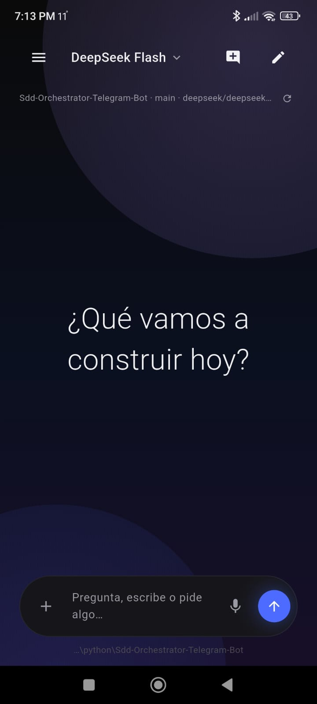
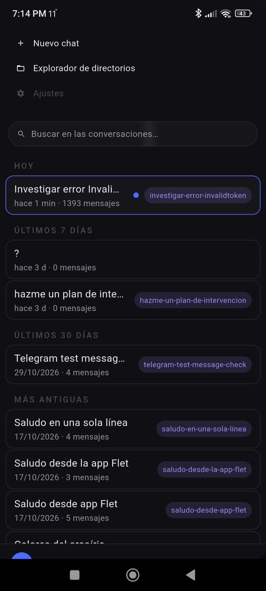
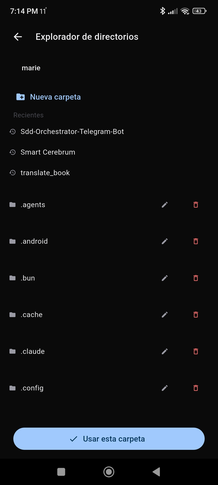
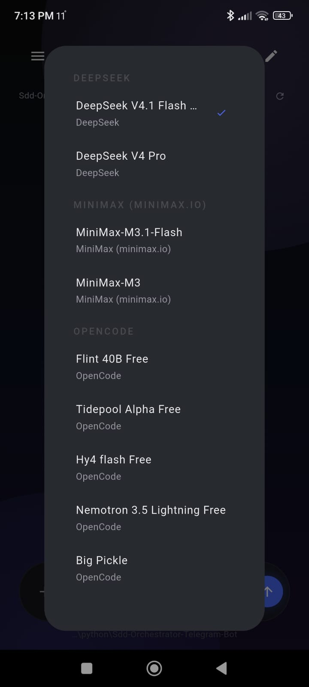

# Sdd-Orchestrator-Bot

Una **puerta de entrada personal al desarrollo con IA**: un solo bot que conecta a tus clientes (Telegram y una interfaz gráfica en Flet) con un agente de programación por CLI. El bot se encarga del ciclo de vida del agente, de los permisos interactivos y de la continuidad de las sesiones, para que puedas dirigir trabajo real de software desde el teléfono.


## Qué es

Trabajar con un agente de programación normalmente significa quedarse frente a una terminal. Este proyecto elimina esa restricción: el servidor se ejecuta en un VPS Linux, la aplicación vive en tu teléfono y un solo bot es el puente entre ambos. Recibe los prompts, transmite en vivo el avance del agente, reenvía las solicitudes de permisos para que las apruebes y mantiene cada conversación reanudable tras los reinicios.

El bot es deliberadamente **agnóstico del frontend**. Toda la lógica de negocio vive en un núcleo puro en `services/`; Telegram (`frontends/telegram/`) y la aplicación Flet (`flet_app/`) son adaptadores delgados que implementan los puertos del núcleo. El mismo punto de composición `build_prompt_stack()` alimenta a ambos, de modo que los dos clientes comparten una única ruta de orquestación en lugar de divergir. Cambiar o añadir un frontend —o el backend de IA detrás del puerto `AIBackend`— nunca toca el dominio.

Hoy el único backend de agente implementado y funcional es **OpenCode** (servidor HTTP por defecto, CLI como rollback). El puerto `AIBackend` es el punto de extensión previsto para **adaptadores futuros (Codex, Claude Code, …), que están en desarrollo** y todavía no forman parte de las funcionalidades disponibles.

### Telegram de un vistazo

| Comando | Qué hace |
|---|---|
| `/status` | Sesión activa, modelo y tiempo en línea |
| `/model <alias>` | Cambia de modelo (alias o id del catálogo) |
| `/session new · list · switch · delete` | Gestiona sesiones con nombre |
| `/config` | Modelo, timeout, directorio de trabajo y proveedor por chat |
| `/cancel` | Cancela el prompt en ejecución |
| `/open <prompt>` | Envía un prompt explícito |
| `/pr <title>` | Abre un PR de GitHub con `gh` |
| `/update` | `git pull` + reinicio limpio (código de salida `42`) |
| _(texto libre)_ | Envía un prompt a la sesión activa |

La referencia completa de comandos está en [DOCUMENTACION.md](DOCUMENTACION.md) §7.

## Capturas de pantalla









## Funcionalidades

- **Chat con streaming en vivo y Markdown legible.** Telegram renderiza MarkdownV2 con un fallback automático a texto plano y división de mensajes largos; la interfaz Flet muestra una cola animada del asistente. Transcripción opcional de notas de voz (Whisper) cuando `OPENAI_API_KEY` está definida.
- **Sesiones: cambiar, recientes, nueva.** Sesiones con nombre por conversación, agrupadas por recencia en el panel, con directorios de trabajo por sesión. El estado se persiste y es seguro entre hilos.
- **Permisos interactivos en ambos frontends.** Una `ask` del agente se convierte en botones en línea en Telegram o en un diálogo modal en Flet. La espera humana no tiene límite por defecto y no consume el timeout del prompt.
- **Explorador de directorios.** Navega, crea, renombra, elimina y selecciona directorios de trabajo desde una vista de migas de pan, además de las cinco carpetas más recientes por conversación, con protección mediante un perímetro del directorio home y comprobaciones de escape por symlink.
- **Modo de edición.** Renombra en línea los títulos de las sesiones vinculadas al bot desde el panel; si algo falla, el modo de edición permanece activo para que puedas reintentar.
- **Selector de modelo respaldado por el catálogo real.** El selector lee la lista `providers` en vivo del agente y muestra solo los modelos que el agente puede ejecutar, agrupados por proveedor, con el modelo activo de la conversación marcado.
- **Ciclo de vida del servidor con un supervisor.** El bot adopta un `opencode serve` saludable o lanza el suyo propio, espera en `/global/health` y lo supervisa; al apagarse solo detiene las instancias que él mismo inició, de modo que el bot y la GUI pueden compartir un mismo servidor.
- **Dos frontends, un solo núcleo.** Telegram en producción y una GUI Flet 1.0.3 pensada primero para móvil, ambas compuestas a partir de los mismos servicios y puertos.

## Arquitectura

```text
  Telegram (phone) ──┐
                     ├── ports ──►  CORE (services/)  ──►  AIBackend  ──►  OpenCode server / CLI
  Flet GUI (phone) ──┘             domain · orchestration · persistence
```

La regla que sostiene todo el diseño es una sola y verificable:

> `services/` nunca importa `telegram`, `flet`, `frontends/`, `handlers/` ni `bot.py`.

No es una convención: `tests/test_core_isolation_boundary.py` importa cada módulo del núcleo en un subproceso y verifica que Telegram y Flet no entren en `sys.modules`; después inspecciona estáticamente `services/**` en busca de importaciones prohibidas. Cualquier intento futuro de «importar telegram en el núcleo» hace fallar la suite de pruebas.

### Tres capas

| Capa | Vive en | Responsabilidad | Puede importar |
|---|---|---|---|
| Núcleo | `services/`, `core_config.py`, `formatting/`, `opencode/`, `persistence/` | Dominio, orquestación, persistencia y contratos | stdlib + `core_config` |
| Frontends | `frontends/telegram/`, `flet_app/`, `handlers/`, `bot.py` | Transporte, UI, autenticación y composición | todo el núcleo |
| API (futura) | — | Expone el núcleo sobre HTTP | el núcleo |

### Puertos

| Puerto | Contrato | Telegram | Flet |
|---|---|---|---|
| `ChatView` + `CoreStrings` | `services/chat_view.py` | `frontends/telegram/chat_view.py` | `flet_app/flet_chat_view.py` |
| `PermissionPort` / `PermissionPresenter` | `services/permissions.py` | `frontends/telegram/permission_presenter.py` | `flet_app/flet_permission_presenter.py` |
| `AIBackend` | `services/ai_backend.py` | Backend OpenCode server / CLI | el mismo |
| `FrontendGate` | `services/frontend_gate.py` | `TelegramGate` (allow-list) | `AllowAllGate` |
| `ConversationKey` | `services/conversation.py` | `telegram:{chat_id}` | `flet:local` |

`bot.py` y `flet_app/main.py` son los puntos de composición: cada uno llama a `build_prompt_stack()` e inyecta sus propios adaptadores. El núcleo nunca sabe que alguno de los dos frontends existe.

El razonamiento de diseño, las alternativas descartadas y la migración de `sessions.json` están documentados en:

- [ADR 0001 — Frontend-agnostic core](docs/adr/0001-frontend-agnostic-core.md)
- [ADR 0002 — Opaque conversation key](docs/adr/0002-conversation-key.md)

## Stack

- **Python 3.13** (`requires-python >= 3.11` declarado; la CI cubre de 3.11 a 3.13)
- **python-telegram-bot 21+** para el transporte de Telegram
- **Flet 1.0.3** para la GUI pensada primero para móvil (extra `[gui]`)
- **httpx** para el cliente HTTP/SSE de OpenCode
- **SQLite** para lecturas de sesión rápidas y de solo lectura directamente desde `opencode.db` (con fallback a la CLI)
- **pytest + pytest-asyncio** para las pruebas, **mypy --strict** para los tipos y **ruff** para lint/formato
- **OpenCode** como backend del agente (modo servidor por defecto, CLI como rollback)

## Inicio rápido

**Requisitos previos:** Python 3.11+, Node.js y la CLI de OpenCode (`npm install -g opencode-ai`), un token de bot de Telegram de [@BotFather](https://t.me/BotFather) y tu chat id (ejecuta `get_chat_id.py`). La aplicación Flet necesita el extra `gui`.

Usa el intérprete del entorno virtual en cada comando: `.venv\Scripts\python.exe` en Windows y `.venv/bin/python` en POSIX.

### POSIX

```bash
git clone https://github.com/JosedeJesusAndrade/Sdd-Orchestrator-Bot.git
cd Sdd-Orchestrator-Bot

python3 -m venv .venv
source .venv/bin/activate
.venv/bin/python -m pip install -e ".[dev,gui]"

cp .env.example .env          # then fill in TELEGRAM_BOT_TOKEN, ALLOWED_CHAT_IDS, …

.venv/bin/python bot.py                 # Telegram bot
.venv/bin/flet run flet_app/main.py     # Flet GUI
.venv/bin/python -m pytest              # test suite
```

### Windows (PowerShell)

```powershell
git clone https://github.com/JosedeJesusAndrade/Sdd-Orchestrator-Bot.git
cd Sdd-Orchestrator-Bot

python -m venv .venv
.\.venv\Scripts\Activate.ps1
.\.venv\Scripts\python.exe -m pip install -e ".[dev,gui]"

Copy-Item .env.example .env   # then fill in TELEGRAM_BOT_TOKEN, ALLOWED_CHAT_IDS, …

.\.venv\Scripts\python.exe bot.py                # Telegram bot
.\.venv\Scripts\flet.exe run flet_app/main.py    # Flet GUI
.\.venv\Scripts\python.exe -m pytest             # test suite
```

`pip install -e ".[dev]"` es suficiente si solo necesitas el bot de Telegram y las herramientas; añade `[gui]` para la aplicación Flet. El modo servidor también requiere `OPENCODE_SERVER_PASSWORD` (autenticación básica); define `OPENCODE_BACKEND=cli` para ejecutar sin ella. Todas las variables están documentadas en [`.env.example`](.env.example) y en [DOCUMENTACION.md](DOCUMENTACION.md) §3.

## Estado del proyecto

- ✅ **1,123 pruebas aprobadas** (2 pruebas solo para POSIX omitidas en Windows)
- ✅ **mypy --strict:** 0 errores en 196 archivos
- ✅ **ruff:** lint y formato limpios
- ✅ **3 cambios SDD archivados:** `core-isolation` (núcleo agnóstico del frontend + ADR), `flet-data-layer` (servicios, DTO y controladores headless), `flet-ui` (shell móvil centrado en el chat, panel, explorador, modo de edición y selector de modelo)

Este es un proyecto personal mantenido por un solo autor. Tiene forma de producción (servidor supervisado, límite de arquitectura impuesto y tipado estricto), pero está hecho para el flujo de trabajo de un único operador.

## Documentación

- [DOCUMENTACION.md](DOCUMENTACION.md) — referencia técnica detallada: arquitectura, configuración, sesiones, backends, permisos, pruebas y resolución de problemas
- [docs/adr/](docs/adr/) — registros de decisiones de arquitectura (ADR) con contexto, alternativas y consecuencias

## Licencia

Este proyecto se distribuye bajo la GNU General Public License v3.0. Ver [LICENSE](LICENSE).

Se eligió el copyleft de la GPLv3 para que cualquier versión derivada del bot permanezca libre y disponible para la comunidad.
